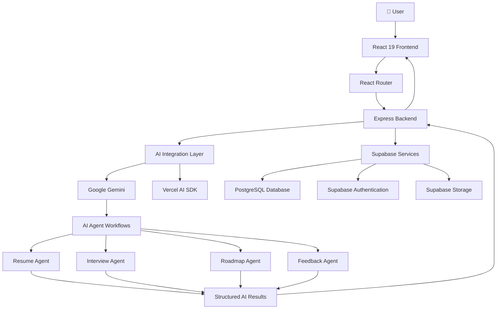
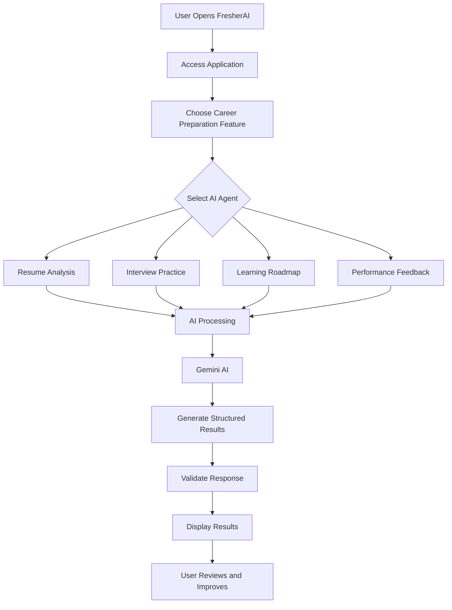

# 🚀 FresherAI — Your AI-Powered Career Preparation Platform

<p align="center">
  <strong>Prepare. Improve. Succeed.</strong>
  <br />
  An intelligent career preparation platform powered by multiple AI agents.
  <br /><br />
  <a href="https://github.com/yash-devlabs/FresherAi">GitHub Repository</a>
  &nbsp; • &nbsp;
  <a href="https://vercel.com/">Vercel Deployment</a>
</p>

<p align="center">
  
  
  
  
</p>

<p align="center">
  
  
  
  
  
</p>

---

## 💡 What is FresherAI?

**FresherAI** is a multi-agent AI-powered career preparation platform designed to help students and fresh graduates become career-ready.

Preparing for a job requires more than just a good resume. Candidates need to understand their strengths, identify skill gaps, practice interviews, and follow a structured learning path.

FresherAI brings these essential activities together in one platform through four specialized AI agents.

Instead of switching between multiple career preparation tools, users can access an integrated experience to prepare, practice, analyze, and improve.

## ✨ Core Features

<table>
<tr>
<td width="50%">

### 📄 Resume Agent
- AI-powered resume analysis.
- ATS-oriented resume evaluation.
- Resume improvement suggestions.
- Identification of missing skills and keywords.

</td>
<td width="50%">

### 🎯 Interview Agent
- AI-powered interview practice.
- Interactive interview experience.
- Questions based on career preparation.
- Feedback to improve interview performance.

</td>
</tr>
<tr>
<td width="50%">

### 🗺️ Roadmap Agent
- Personalized learning roadmaps.
- Structured career preparation.
- Skill development guidance.
- Learning recommendations.

</td>
<td width="50%">

### 📊 Feedback Agent
- Performance feedback.
- Identification of improvement areas.
- Actionable recommendations.
- Continuous career preparation insights.

</td>
</tr>
</table>

## 🤖 Meet the Four AI Agents

FresherAI follows a specialized-agent approach, where each agent is responsible for a particular career preparation task.

| AI Agent | Responsibility |
|---|---|
| Resume Agent | Resume analysis and ATS-oriented feedback |
| Interview Agent | Interview preparation and practice |
| Roadmap Agent | Personalized learning and skill development |
| Feedback Agent | Performance evaluation and improvement suggestions |

The goal is to make career preparation more structured, personalized, and accessible.

## 🏗️ System Architecture

FresherAI uses a frontend-backend architecture with dedicated responsibilities for the user interface, server-side processing, AI integration, and data management.

### Architecture Overview



### How the Architecture Works

1. **Frontend Layer:** React renders the user interface and manages navigation and user interactions.
2. **Routing Layer:** React Router handles application navigation.
3. **Backend Layer:** Express handles API requests and server-side processing.
4. **AI Layer:** Google Gemini, integrated through the Vercel AI SDK, powers AI-related functionality.
5. **Database Layer:** Supabase provides PostgreSQL database services, authentication, and storage.
6. **Validation Layer:** Zod supports structured data validation.
7. **Deployment Layer:** Vercel provides the deployment environment.

## 🛠️ Technology Stack

### Frontend Development

| Technology | Purpose |
|---|---|
| React 19 | Component-based user interface |
| JavaScript (ES6+) | Application logic |
| JSX | UI structure |
| HTML5 | Web page structure |
| Tailwind CSS 4 | Styling and responsive design |
| Vite 8 | Development server and build tooling |
| React Router 7 | Client-side navigation |
| Lucide React | Icons |
| TanStack React Query | Data and server-state management |

### Backend Development

| Technology | Purpose |
|---|---|
| Node.js | JavaScript runtime |
| Express 5 | Backend API framework |
| REST APIs | Frontend-backend communication |
| dotenv | Environment configuration |
| CORS | Cross-origin request configuration |

### Artificial Intelligence

| Technology | Purpose |
|---|---|
| Google Gemini | Generative AI capabilities |
| Vercel AI SDK | AI integration |
| @ai-sdk/google | Google Gemini provider |
| Zod | Structured output validation |

### Database & Cloud Services

| Technology | Purpose |
|---|---|
| Supabase | Backend-as-a-Service |
| PostgreSQL | Relational database |
| Supabase Auth | Authentication |
| Supabase Storage | File storage |
| Vercel | Application deployment |

### Additional Libraries & Tools

- **jsPDF:** PDF generation.
- **Lucide React:** Icon library.
- **Concurrently:** Running multiple development processes.
- **Git & GitHub:** Version control and source code management.
- **npm:** Package management.

## 🔄 Application Workflow



## 📂 Project Structure

The repository is organized by responsibility to keep the application maintainable and beginner-friendly.

```text
FresherAi/
│
├── api/
│   └── Vercel API adapter
│
├── authentication/
│   └── Authentication documentation
│
├── backend/
│   └── Express server and API logic
│
├── database/
│   └── migrations/
│       └── Database migration files
│
├── frontend/
│   └── React application and UI
│
├── scripts/
│   └── Development startup scripts
│
├── .env.example
├── .gitignore
├── package.json
├── package-lock.json
├── vercel.json
├── vite.config.js
│
└── README.md
```

## ⚙️ Getting Started

Follow these steps to run FresherAI locally.

### 1. Prerequisites

Make sure you have installed:

- Node.js (compatible with the project dependencies).
- npm.
- Git.
- A Supabase project.
- A Google Gemini API key.

### 2. Clone the Repository

```bash
git clone https://github.com/yash-devlabs/FresherAi.git

cd FresherAi
```

### 3. Install Dependencies

```bash
npm ci
```

### 4. Configure Environment Variables

Create your local environment file:

```bash
cp .env.example .env
```

Add the required configuration:

```env
# Supabase Configuration
SUPABASE_URL=your_supabase_url
SUPABASE_PUBLISHABLE_KEY=your_supabase_publishable_key

# Frontend Supabase Configuration
VITE_SUPABASE_URL=your_supabase_url
VITE_SUPABASE_PUBLISHABLE_KEY=your_supabase_publishable_key

# Google Gemini API
GEMINI_API_KEY=your_gemini_api_key

# Optional: Multiple Gemini API Keys
GEMINI_API_KEYS=key1,key2,key3

# Frontend URL
FRONTEND_URL=http://localhost:5173

# Backend Port
PORT=5001
```

**Important:** Never expose Gemini API keys in frontend code or commit your `.env` file to GitHub.

### 5. Start the Development Server

```bash
npm run dev
```

The application uses the following default local ports:

| Service | URL |
|---|---|
| React Frontend | http://localhost:5173 |
| Express Backend | http://localhost:5001 |

### 6. Build for Production

```bash
npm run build
```

### 7. Run Tests

```bash
npm test
```

## ☁️ Deployment

FresherAI is configured for deployment using **Vercel**.

The production build is generated using Vite, while the backend is integrated through the Vercel API adapter.

### Deployment Steps

1. Push the latest project code to GitHub.
2. Import the repository into Vercel.
3. Configure the required environment variables.
4. Verify the Supabase and Gemini configurations.
5. Deploy the application.
6. Test authentication, AI functionality, and database connectivity.

### Required Vercel Environment Variables

```text
SUPABASE_URL
SUPABASE_PUBLISHABLE_KEY
SUPABASE_ANON_KEY (alternative)
VITE_SUPABASE_URL
VITE_SUPABASE_PUBLISHABLE_KEY
VITE_SUPABASE_ANON_KEY (alternative)
GEMINI_API_KEY
GEMINI_API_KEYS
FRONTEND_URL
```

Use the appropriate Supabase key configuration rather than exposing a service-role key to browser requests.

## 🔐 Security Considerations

- Keep private API credentials on the server.
- Never commit `.env` files.
- Use Supabase authentication for user identity.
- Validate structured input and output where appropriate.
- Configure CORS according to the deployment environment.
- Avoid exposing sensitive database credentials in client-side code.

## 🎓 Project Objectives

FresherAI was developed with the following objectives:

- Simplify career preparation for students and fresh graduates.
- Integrate multiple AI-powered career tools into one platform.
- Provide personalized learning and improvement guidance.
- Make interview and resume preparation more accessible.
- Demonstrate the practical application of generative AI in career development.
- Build a modular and maintainable full-stack application.

## 🚀 Future Scope

Potential areas for further development include:

- More advanced resume optimization.
- Expanded interview question categories.
- Improved personalization across AI agents.
- More detailed career analytics and progress tracking.
- Additional learning resources and integrations.
- Enhanced AI evaluation and recommendation workflows.

*These are potential enhancements, not claims that every feature is already implemented.*

## 👨‍💻 Developed By

**Yash Pradhan**

Computer Engineering | AI & Full-Stack Development

- GitHub: [@yash-devlabs](https://github.com/yash-devlabs)
- Project: [FresherAI Repository](https://github.com/yash-devlabs/FresherAi)

---

<p align="center">
  <strong>FresherAI — Prepare. Improve. Succeed.</strong>
  <br />
  Built to make career preparation smarter with AI.
  <br /><br />
  ⭐ If you find this project interesting, consider starring the repository!
</p>
---

<p align="center">
  ⚖️ <a href="LICENSE"><strong>MIT License</strong></a>
  <br />
  Copyright © 2026 Yash Pradhan
</p>
